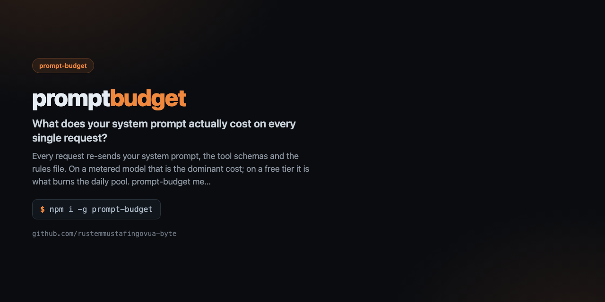

<div align="center">



# prompt-budget

**What does your system prompt actually cost on every single request?**

[](https://github.com/rustemmustafingovua-byte/prompt-budget/actions/workflows/ci.yml)
[](https://www.npmjs.com/package/prompt-budget)
[](./LICENSE)
[](https://nodejs.org)
[](https://base.org)

[**Docs**](https://rustemmustafingovua-byte.github.io/prompt-budget/) · [Issues](https://github.com/rustemmustafingovua-byte/prompt-budget/issues) · [Discussions](https://github.com/rustemmustafingovua-byte/prompt-budget/discussions)

</div>

---

Every request re-sends your system prompt, the tool schemas and the rules file. On a metered model that is the dominant cost; on a free tier it is what burns the daily pool. prompt-budget measures all of it before you ship it.

## Install

```bash
# tarball из релиза: без токена и без npm-логина
npm i -g https://github.com/rustemmustafingovua-byte/prompt-budget/releases/download/v0.1.0/prompt-budget-0.1.0.tgz
```

<details>
<summary>Через GitHub Packages</summary>

```bash
npm i -g @rustemmustafingovua-byte/prompt-budget --registry=https://npm.pkg.github.com
```

</details>
## What it does

| | |
|---|---|
| **Token estimate for rules files** | sections, code blocks, the expensive parts |
| **Token cost of tool schemas** | which tools eat the context |
| **Cost per request and per session** | with your own prices |
| **Actionable advice** | what to cut and what to move into a skill |


## Usage

```bash
prompt-budget AGENTS.md
prompt-budget AGENTS.md --tools tools.json --calls 50
```

## CLI

```
prompt-budget — What does your system prompt actually cost on every request?

USAGE
  prompt-budget AGENTS.md
  prompt-budget AGENTS.md --tools tools.json --calls 50

COMMANDS / OPTIONS
  --tools <file>     also measure the tool schemas
  --calls <n>        requests per session (default 50)
  --price-in <usd>   input price per 1M tokens (default 3)
  --price-out <usd>  output price per 1M tokens (default 15)

MIT · https://github.com/rustemmustafingovua-byte
```

## Part of a portfolio

| Project | What it does |
|---|---|
| [`opencode-free-stack`](https://github.com/rustemmustafingovua-byte/opencode-free-stack) | route to free models, fall back automatically |
| [`free-web-mcp`](https://github.com/rustemmustafingovua-byte/free-web-mcp) | web search for agents, zero credits |
| [`agent-x402`](https://github.com/rustemmustafingovua-byte/agent-x402) | pay per API call in USDC with a spend policy |

## Donate

MIT, forever. USDC on Base:

```
0x8aC6a229f254980CCd3Dd35CF5E1B7c08880B40E
```

## License

MIT © rustemmustafingovua-byte
